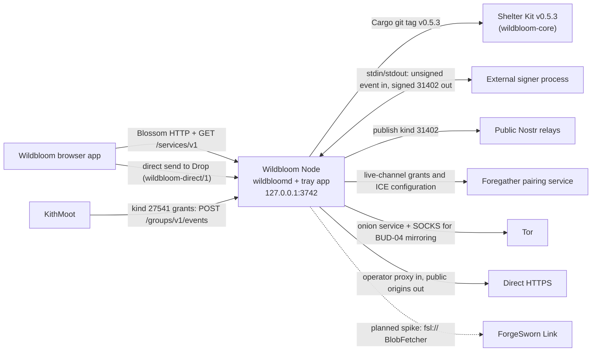

# Where Wildbloom Node fits

Wildbloom Node is a self-hosted Blossom storage node: the `wildbloomd` daemon and a Tauri tray app that launches it. It is the shell around [Shelter Kit](https://github.com/forgesworn/shelter-kit), which owns the Blossom behaviour, so most of this page is about the edges the shell adds: a listener, Tor or HTTPS reachability, an external signer and optional Nostr discovery. Internals are in [ARCHITECTURE.md](ARCHITECTURE.md); this page covers only who the node talks to and how.

| Neighbour | Relationship | Interface | Status |
| --- | --- | --- | --- |
| Shelter Kit | Library dependency that owns the router, BUD authorisation, content-addressed store, quota and repair | `wildbloom-core = { package = "shelter-kit", git, tag = "v0.5.3" }` (`Cargo.toml`), used by `wildbloomd` and `wildbloom-checkout`; mirror and repair bytes arrive through `BlobFetcher` | Built |
| Wildbloom browser app | Client of the node; no code dependency in either direction | Standard Blossom HTTP on the node's onion, HTTPS or local origin: `GET` and `HEAD` by hash, `PUT /upload`, `PUT /mirror`, kind 24242 BUD-11 authorisation; unsigned `GET /services/v1`; the app's `/send` page to Drop for direct send (`wildbloom-direct/1`, `PROTOCOL.md`). The app finds nodes through kind 31402 on relays the user configured, then fetches `/services/v1` ([app side](https://github.com/forgesworn/wildbloom/blob/main/docs/NODE-SERVICES.md)) | Built; `/services/v1` exists only with `--service-profile` |
| External signer process | Signs the service announcement so the daemon never holds a service secret key | Absolute executable path in the service profile; one unsigned Nostr event as bounded JSON on stdin, one signed event on stdout; ten-second deadline; the daemon verifies the signature and exact event ID | Built; opt-in |
| Public Nostr relays | Receive the signed kind 31402 service announcement | NIP-01 `EVENT` and `OK` over `wss://`, at most eight explicitly configured relays; `direct` to pinned public addresses (needs `--no-tor`) or `tor-only` through SOCKS; relay AUTH unsupported | Built; opt-in. Live relay retrieval is still an acceptance gate |
| Foregather pairing service | Provides the word-verified live channel behind Drop's Share and direct send; the node can hand devices one-use creation grants | `--pairing-issuer --pairing-relay-url <foregather base>` (with `--device-grants`): `POST /pairing/v1/live-grants` under NIP-98, which calls Foregather's `POST /v1/creation-grants` with an operator token; `--turn-issuer`: `POST /turn/v1/credentials` returns the ICE configuration. The node takes no part in a direct-send transfer | Built; opt-in. Direct send is experimental |
| KithMoot | A room keeper's signed grants admit that room's devices to a closed node | `--group-mode` and `--group-keeper`; keeper-signed kind 27541 events at `POST /groups/v1/events` (`GROUP-GRANTS.md`) | Node side built; KithMoot's keeper support is experimental |
| Tor | Onion reachability and the path for mirroring from onion origins | Managed Tor from the signature-verified Tor Expert Bundle publishes a persistent v3 onion service; the private loopback SOCKS listener (or a supplied loopback `socks5h` proxy) feeds `TorHttpFetcher` | Built; the headless default, skipped with `--no-tor` |
| Direct HTTPS | Reachability behind an operator-run reverse proxy; mirroring from public origins | `--no-tor`, `--public-url`, `--direct-https-mirrors`; `DirectHttpsFetcher` reaches public HTTPS origins only | Built |
| ForgeSworn Link | Candidate native transport for mirror and repair | None today. It would be an optional `BlobFetcher` adapter over `fsl://` and would never be required of the default Tor node (`ARCHITECTURE.md`, `ROADMAP.md`) | Planned spike, not built |

## What this repo leaves to others

- Blossom semantics, BUD-01/02/04/06/11/12 verification, quota reservation, integrity checks and repair: Shelter Kit. The shell supplies the `Wildbloom Node` identity, process configuration, listener and shutdown.
- Client-side encryption, erasure coding and reconstruction, and the user interface: the browser app. The node stores the bytes it is sent, normally ciphertext, and the tray app never asks for a Nostr private key.
- Choosing a node: the client selects explicitly. Signed relay metadata does not establish who controls an HTTPS origin and never triggers a purchase (`SERVICE-DISCOVERY.md`).
- Whether a relay keeps or serves an announcement: an `OK` is not proof of retention.
- Payment rails (Phoenixd, LNURLcash) and wallet credentials: the operator (`CHECKOUT.md`).
- STUN and TURN for direct send: the operator's own server. With `--turn-issuer` the node only hands out the ICE configuration, with short-lived credentials when a TURN URL is set (`PROTOCOL.md`).

## Not built yet

- A Link lane. The roadmap asks for a spike on two desktops and a physical Android phone, across home NAT, carrier NAT, VPN egress and UDP-blocking networks, before any adapter. ForgeSworn Link has the client side (`link-blossom`); this repo has no dependency on it.
- Real Tor publication of announcements and live operator wallet and mint receipts (`SERVICE-DISCOVERY.md`, "Validation and remaining acceptance").
- Durable replication and replica discovery. Every replica is a complete Blossom blob and no durability is claimed (`README.md`, `ROADMAP.md`).

Checked against wildbloom-node eb482b6, shelter-kit v0.5.3, wildbloom ee21ed5, forgesworn-link 7aad8bf and kithmoot cede413c on 6 November 2026.
